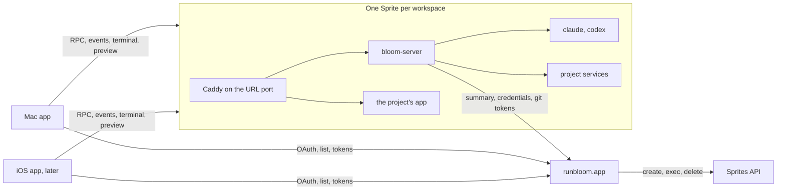

# Cloud workspaces on Sprites

Status: design, September 2026. Nothing here is built yet. This document is what the next pull
request builds, and the order it builds it in. The control server half lives in the runbloom.app
repository and is designed there; the contract between the two is written down here as well,
because both sides have to read the same one.

A cloud workspace is a Bloom workspace whose worktree, agents, terminals and transcript live on a
Fly.io Sprite instead of this Mac. One Sprite per workspace, and the Sprite is the isolation
boundary. Several people can work in the same one.

**Nobody using Bloom sees Fly or a Sprite.** runbloom.app runs every cloud workspace in one Fly
organisation with one token, for every team; nobody connects a Fly account. In the app (sidebar,
create window, menus, errors), on runbloom.app and in any message a person can read, it is a
**Cloud workspace**, plural **Cloud workspaces**, and never a remote workspace, a Fly machine or a
Sprite. Type names in code stay neutral (`Remote…`, `Machine…`), because they are not read by
anyone using the app. "Sprite" appears in this document, in the provider implementation and in
logs, and nowhere else. The provider stays behind the interface described under "Where the code
goes", so a second provider changes no user-facing word.

What this replaces: the self-provisioned SSH server of pull request #163 (install scripts, SSH
wizard, rootless Docker, swap, storage cleanup, server updates) is dropped entirely. #163 stays open
as a quarry; "Two pull requests, and what comes from #163" says what is taken from it and what is not.

## Measured facts this design rests on

These come from spikes on real Sprites in September 2026 and are the reason for most decisions
below. Change a fact and look again at the decision that cites it.

- Create takes 0.4 to 0.7 s. Ubuntu 26.04 x86_64, 8 vCPU, 8 to 16 GB memory scaled
  automatically, 99 GB disk, passwordless sudo, no systemd (tini is PID 1). `claude`, `codex`,
  `gh`, `git`, `tmux`, `node`, `python` and `go` are preinstalled. The #163 Linux package already
  targets this OS.
- About 30 s after activity stops a Sprite pauses: billing stops and processes freeze. Warm wake
  measured 0.87 s. After about 10 minutes it goes cold; the documentation says memory is dropped,
  and a measured cold wake took 0.4 s with a process still alive. **Every open TCP connection
  breaks on a pause.**
- A Sprite Service restarts on cold wake. Background processes do not keep a Sprite awake; open
  connections through a service do. A task on the Tasks API (`/.sprite/api.sock`) holds it awake
  for up to an hour with a heartbeat, verified for 100 s with nothing connected. **A turn that does
  not hold a task has its model call broken by a pause.**
- The Sprite URL routes to one HTTP port. It is private (Fly organisation login or an organisation
  token) or public. `sprite proxy` streamed SSE for 190 s.
- A Sprite cannot be created from another Sprite's checkpoint. Checkpoints restore only into the
  Sprite they came from, so every workspace sets up from nothing.
- Sprites never delete themselves and storage bills until they are deleted.
- A service another service depends on cannot be deleted, and creating a service under an
  existing name silently keeps the old definition.
- Price: $0.07 per CPU hour used, $0.04375 per GB hour of memory used, $0.50 per GB month of hot
  storage while running, $0.02 per GB month of storage always.
- Docker on a Sprite is fragile: no memory cgroup controller, `docker exec` into a non-root
  container needs `init: true`, rootless Docker fails, BuildKit intermittently fails reading
  `/proc/meminfo`. spatie/there-there.app set up natively (Postgres with pgvector, Redis, Horizon,
  Reverb, Vite, Caddy) served its homepage 149 s after create; with Docker it took about 7.5
  minutes. Apt was 79 s of the 149, seeding 42 s, upload 17 s. It needed `APP_URL` set to the
  Sprite URL and `__VITE_ADDITIONAL_SERVER_ALLOWED_HOSTS` in the process environment rather than
  `.env`.

## The shape



**runbloom.app** owns accounts, teams and membership, authorisation, the workspace registry with a
summary per workspace, Sprite lifecycle (create, bootstrap, update, delete, orphan sweep),
provider credentials, agent and environment secrets, the GitHub App, and push notifications.
It never carries transcript, terminal or preview bytes: it is a single core Forge box running
PHP-FPM, and a long-lived stream is the one thing it is bad at.

**bloom-server** runs inside the Sprite and owns exactly one workspace: its checkout, agent
processes, prompt queue, transcript, terminals, project services, setup and the Sprite's awake
state. It is the #163 runtime cut down, with an HTTP front instead of a Unix socket behind a Go
gateway.

**Clients** sign in to runbloom.app, list workspaces from it without waking anything, and talk to
a Sprite directly with a short-lived token runbloom.app issued for that one workspace.

Clients stream from the Sprite rather than through runbloom.app. The alternative that keeps Sprite
URLs private is a relay holding a Fly organisation token, and that relay could not be PHP, so it
would be a third service to deploy and operate for one benefit (a private URL) that bloom-server's
own token check provides as well. If that changes, the relay slots in front of the same endpoints
without a protocol change.

## Identity and tokens

### Signing in

The Mac signs in to runbloom.app with OAuth 2 authorisation code and PKCE against Laravel Passport:
a public client with no secret, and refresh tokens in the Keychain. The redirect is
`bloom://oauth/callback`, and `bloomdev://oauth/callback` for Bloom Dev, which has its own scheme.
There is no loopback redirect, because Passport compares redirect URIs exactly and a loopback
redirect carries a different port every time. `BloomAuthentication` from #163 wraps AppAuth, whose
Mac user agent is `ASWebAuthenticationSession`, which takes a custom scheme callback; #163 used it
with loopback, so the Mac path changes to the custom scheme. It reads its endpoints from a
`/.well-known/bloom-auth` document, which runbloom.app can serve, or they can be configured in the
app. runbloom.app's own API uses those access tokens.

### Workspace tokens

A client exchanges its runbloom.app access token for a workspace token:
`POST /api/workspaces/{id}/session-token`. The reply is an EdDSA JWT, five minutes long:

| Claim | Value |
| --- | --- |
| `iss` | `https://runbloom.app` |
| `aud` | `bloom-workspace:<workspace id>` |
| `sub` | user id |
| `name` | display name, for presence |
| `team` | team id |
| `abilities` | subset of `view`, `prompt`, `terminal`, `files`, `preview`, `share` |
| `iat`, `exp`, `jti` | `exp` is `iat` + 300 |

The header carries `kid`. Abilities rather than a role, so a read-only viewer later is a
different set of strings and not a format change.

bloom-server verifies offline against runbloom.app's JWKS. The issuer and the JWKS URL are written
into the Sprite at bootstrap, never read from the token. The key set is cached and refetched on an
unknown `kid`, at most once a minute. Verification is Ed25519 through swift-crypto, which the Linux
build already depends on; no JWT library.

Every request and every stream open checks a token. An open stream remembers its token's `exp`, and
the client sends a fresh token on it at least 60 s before (a `reauth` frame on a WebSocket, `POST
/_bloom/v1/streams/{id}/token` for an event stream). A stream whose token expires is closed with
`token_expired`. Removing someone from a team takes effect within five minutes by expiry, and at
once when runbloom.app calls `POST /_bloom/v1/control/revoke`, which closes that user's streams.

runbloom.app stores only a hash of the workspace secret, so it cannot use that secret to call the
Sprite. It signs its own token instead, verified against the same pinned key set: `aud`
`bloom-workspace:<id>` for that one workspace, `sub` `control`, the `admin` ability that no user
token carries, and a 60 s lifetime. The Sprite remembers each `jti` until it expires and refuses a
replay. That covers every call from runbloom.app to a Sprite: revoke, update, pushing changed
environment.

### The workspace secret

Generated at create, stored hashed on runbloom.app, written to the Sprite at
`/etc/bloom/workspace.json` (mode 600) at bootstrap, and revoked on archive. It authorises the Sprite towards runbloom.app and nothing wider than its own workspace:
posting its own summary, fetching git tokens for its own repository, fetching team and project
environment, and starting a turn a user has already registered (below).

An agent in the Sprite has passwordless sudo and can read that file, and it can read the
environment of its own process. That is accepted: the Sprite is the isolation boundary, everything
reachable from it is scoped to one workspace, and the agent credential is visible to the agent in
every design where the unmodified CLI runs. What narrows the damage is short lifetimes, a narrow
secret, and (later, per project) the Sprite's DNS egress allowlist.

## Agent credentials

Anthropic's Claude Code terms settle this. A product that hosts Claude Code needs the Commercial
Terms; each end user authenticates with their own API key or subscription; usage is not paid for or
resold on their behalf; and "developers may not collect, store, or intermediate Claude.ai
credentials or session tokens", with sign-in completing through Anthropic's own flow. The same page
permits a customer to configure its own API key for its own authorised users, billed to the key
owner, and permits an end user to sign in to the unmodified binary with their own subscription on a
hosted platform. OpenAI recommends API keys for automation and treats Codex's `auth.json` as a
password.

So:

- **Phase 1 is API keys only.** A team key (Anthropic Console, OpenAI) is the default, and a user
  can add a personal key that overrides it for their own turns, stored encrypted on runbloom.app.
  The key is resolved per turn from the prompter. `claude setup-token` tokens are never stored on
  runbloom.app.
- **Later, personal subscriptions** in workspaces that are not shared: the person runs Claude's own
  `/login` or Codex's device login in the Sprite's terminal, the credential stays on that Sprite, and
  sharing the workspace is refused while it is there. A Codex ChatGPT plan `auth.json` is treated the
  same way.

### How a key reaches a turn

Bloom today keeps one long-lived agent process per chat (Claude stream-json with stdin held open,
the Codex app-server) and relaunches with `--resume` or `thread/resume` after a restart. On a
Sprite:

1. **Registering.** A client sends a prompt with a workspace token carrying `prompt`, fresh at the
   moment of sending. bloom-server passes that token on at once to `POST
   /api/sprite/workspaces/{id}/turns`, and gets back a turn id in state `queued`, stored on the
   delivery. The workspace secret alone cannot get a key: every key is tied to a turn a person
   asked for while their token was valid. Removing a member cancels their queued turns, and a turn
   registered more than 12 hours before it starts is refused.
2. **Starting.** When the delivery reaches the front of the queue, which may be long after that
   token expired, bloom-server calls `POST .../turns/{turn}/start` with the workspace secret. The
   reply carries the resolved key, an identity for it (a hash, not the key), and the prompter's
   personal environment. The key is fetched at every start and never cached across turns.
3. If the running process was started with the same identity, the delivery goes to its stdin. The
   identity is the resolved key, not the person, so teammates sharing the team key never cause a
   relaunch.
4. Otherwise bloom-server waits for the running turn to end, stops the process and relaunches it
   with `--resume` and the key in the process environment only (`ANTHROPIC_API_KEY`,
   `OPENAI_API_KEY`). Resume reloads the session from local files on the Sprite, which is cheap.
   **The prompt cache is not**: a different key is a cache miss, and the first turn after a switch
   pays full input price for the whole context. That only happens when someone with a personal key
   takes a turn after someone on another key.
5. A message from someone else is never injected into a running turn. It queues behind it.
6. **Ending.** `DELETE .../turns/{turn}` when the turn ends, fails or is stopped.

A running process keeps the key it was launched with for as long as consecutive turns resolve to
the same identity. Personal environment applies only to that turn's processes; it is not given to
project services. A terminal session registers the same way with the `terminal` ability, and its
shell gets that person's key, personal environment and GitHub token.

The key is never written to disk, never in argv, and never in the transcript. A cold wake kills
the process, and the next delivery starts again at step 1.

## Collaboration

A workspace is private to its creator until shared with their team, as Amp does it. Phase 1 has
two roles, owner and collaborator; a collaborator can prompt, answer questions, stop a turn, use
the terminal, edit files and open the preview. Only the owner shares, unshares and archives. A
collaborator needs GitHub connected to prompt, because their turns push as them.

The #163 runtime already serves several clients at once, with a durable server-side prompt queue
and last-writer-wins composer settings. What it lacks is who did it: the gateway drops the caller
and messages have no sender. Phase 1 adds:

- **An author on every delivery and every user message**, from the token's `sub`, stored as a
  column and shown on the message. A Store migration, and `update` rather than `upsert` as always.
- **Arrival order.** Prompts from several people queue in the order the server received them. The
  queue is visible to everyone and anyone can cancel a queued prompt, which is recorded.
- **Drafts stay per user and on the client.** Nothing is typed into anyone else's composer.
- **Composer settings** stay last-writer-wins, and the change event names who made it.
- **Questions and permission prompts**: the first answer wins. The runtime already claims a
  request once; a second answer gets "already answered by <name>".
- **Presence**: bloom-server keeps the set of users with an open event stream and the last human
  input per user, and publishes it as an event and in the summary.

## Awake, asleep, and what it costs

An open stream keeps a Sprite awake, so a Mac left open on a workspace would bill until it was
closed. bloom-server therefore decides when it may sleep, and tells clients.

It holds a Tasks API task, renewed by heartbeat, while any of these is true:

- setup or resume is running;
- an agent turn is running, including one waiting on a question (bounded, see below);
- a run script the user started is running;
- the **human presence lease** is live: 15 minutes after the last human input from any client.
  Input is a prompt, an answer, a keystroke in the terminal, a file save, a navigation in the
  preview. An open stream, a visible window or a poll is not input.

The lease is cut short in one case, because it costs one counter the server already has: when the
last client stream closes (the app quit, the workspace closed, the laptop slept), the lease ends two
minutes later if nothing else renewed it. A client that is open but idle is not detected; that would
need every client to report its own visibility, which is more state than the minutes it saves.

When none is true it posts a final summary with `awake: false`, sends `sleeping` on every stream
and closes them. Clients show the runbloom.app summary and reconnect on the next interaction; a
wake is under a second. Project services stay running and freeze with the Sprite, so a Vite HMR
socket in someone's browser does not hold it awake past the lease either: the preview proxy closes
upgraded connections when it sends `sleeping`.

A turn waiting on a question holds the Sprite for at most the presence lease after the question
was asked, then releases it. The question survives the pause; answering wakes the Sprite.

## The protocol

The #163 wire protocol (a tagged JSON envelope, durable command ids, receipts, the operation
inventory in its `docs/SERVER-PROTOCOL.md`) is kept, because its semantics were earned: unknown
outcomes, queued deliveries, revision-checked file writes, archive confirmation. It is **not**
kept compatible: there are no server users, so version negotiation with 12 to 16 goes, and it
starts again as `bloom-workspace` version 1. What changes:

- **One workspace.** Operations lose `workspaceID`, and repository and project operations that only
  make sense on a multi-project server go (`catalogue` becomes `workspace`, `creation`, `project`,
  `storage`, `cleanupStorage`, `skills`, `diagnostics` as it was, Docker fields).
- **Events instead of polling.** #163 clients poll transcripts every second. `GET
  /_bloom/v1/events` is a server-sent event stream: transcript messages by `seq`, streaming text
  as deltas with a snapshot on connect, queue changes, questions, composer changes, setup output,
  review revision bumps, presence, `sleeping`. It resumes from `Last-Event-ID`, which is the
  transcript `seq` it already has, so reconnecting after a pause costs nothing new. Paged
  `transcript` stays for catching up history.
- **Authors** as above.
- **Named fields, not Swift's encoding.** #163's envelope is Swift's synthesised `Codable`, so an
  enum case with an unnamed value is `{"text":{"_0":"..."}}`, dates count from 2001 and failures
  are prose. Version 1 is written for a reader in another language: named fields throughout, ISO
  8601 dates, and failures as `{code, message}` with stable codes. The Swift types encode to that
  shape by hand where synthesis would not.
- **Endpoints**, all on the Sprite URL:

| Path | What |
| --- | --- |
| `POST /_bloom/v1/rpc` | the envelope, bearer token |
| `GET /_bloom/v1/events` | SSE read with `fetch`, bearer token |
| `GET /_bloom/v1/terminal?name=` | WebSocket, `auth` first frame, binary frames, resize and `reauth` text frames |
| `GET /_bloom/preview/enter?t=` | preview cookie exchange |
| `POST /_bloom/v1/control/revoke`, `update`, `environment` | runbloom.app only, `admin` token |
| `GET /_bloom/health` | unauthenticated, version only |
| everything else | the preview |

## Clients other than the Mac

iOS comes later and a web interface may come after it, so the contract is checked against a
browser now rather than discovered to be native-only then.

- **Streams without headers.** A browser's `EventSource` cannot send `Authorization`. The event
  stream is ordinary SSE framing, read with `fetch` and a `ReadableStream`, which can send the
  header, and which is also how the native clients read it. No token goes in a URL, where it would
  land in logs and history. A browser `WebSocket` cannot send a header either, so the terminal
  WebSocket takes its token as the first text frame, `{"kind":"auth","token":"..."}`, and closes
  unauthenticated connections after five seconds. Every client does the same, so there is one path
  to test. Cookies are not used for control: a cookie would put CSRF on the table and share
  authority with the preview on the same origin.
- **CORS.** `/_bloom/v1/*` answers preflight for the origins pinned in `workspace.json` at bootstrap
  (`https://runbloom.app` to start with), allows `Authorization` and `Content-Type`, never allows
  credentials, and caches preflight for ten minutes. The preview paths send no CORS headers of their
  own; what the app sends is the app's business.
- **The preview in a browser** opens top level through the same exchange. Embedding it in a
  runbloom.app page would need the preview cookie as `SameSite=None; Partitioned`, and that decision
  waits for a web client that wants it.
- **The behaviour a client has to get right is written down, not left in Swift.** The protocol
  document that ships with version 1 has a client chapter covering what #163 kept in
  `BloomClient`: merging transcript pages and events by `seq`, applying streaming deltas over the
  snapshot, keeping and retrying a mutation under its original command id, refreshing a workspace
  token before a stream's expires, reconnecting after `sleeping` and waking the machine, review
  revisions and the patch cache, queue and question state, and presence. It ships with a JSON
  Schema and test vectors generated from the Swift types, as #163 did, so a TypeScript client is
  checked against the same examples as the Swift one.

## Preview

The Sprite URL has one port, so it cannot give control and the preview separate origins. A Caddy
supervised by bloom-server listens on it and routes `/_bloom/*` to bloom-server and everything else
to the project's app on `BLOOM_APP_PORT`. Caddy rather than a proxy in Swift, because streaming,
WebSocket upgrades for Vite and Reverb, and header rewriting are what it is for, and the
There There spike already ran one.

Control never reads cookies; it wants `Authorization: Bearer`. The preview wants the
`__Host-bloom-preview` cookie (HttpOnly, Secure, SameSite=Lax, eight hours, bound to a user),
checked by Caddy's `forward_auth` against bloom-server, stripped before the request reaches the
app, and refused if the app tries to set it. So the app's own JavaScript shares an origin with
control and still cannot reach it. A client opens the preview through `GET
/_bloom/preview/enter?t=<60 s single-use preview JWT>`, which sets the cookie and redirects. A share
link is `https://runbloom.app/share/<id>`: runbloom.app checks the share is live, mints a 60 s
preview token for `sub: "share:<id>"` and redirects to the exchange, which sets a cookie lasting
one hour rather than eight. There is no long-lived share token.

## Setup

Every create is cold. A Sprite cannot start from another's checkpoint, and phase 1 has no pool of
prepared machines, so bloom-server runs the whole of it in one go after bootstrap: clone with a
read-only installation token, create the branch, `scripts.prepare`, `scripts.setup`,
`scripts.resume`, then the services, reporting each step in the summary. For There There that is
about two and a half minutes, most of it apt. The opening prompt queues behind setup, as it does
locally.

runbloom.app keeps a Machine record per Sprite, named `bloom-<machine ulid>`. The Sprites HTTP API
cannot set labels, so the mapping from Sprite to workspace lives in its database, and the orphan
sweep deletes a Sprite no Machine owns only when its whole name matches
`^bloom-[0-9a-hjkmnp-tv-z]{26}$`, never on the prefix alone.

Production, development and tests share the one Fly organisation, and there is no staging
environment: end-to-end testing runs against runbloom.app itself behind its access and
configuration switches. So the names keep them apart. Machines created by local development are
named `bloomdev-<...>` and by automated tests `bloomtest-<...>`; neither starts with `bloom-`, so
the production sweep cannot match them however it is written, and nothing that creates or sweeps
development or test machines can match a production one. A test deletes what it created in its
own teardown, and `Tools/sweep-test-machines.sh` deletes `bloomtest-` machines older than a day for
the runs that crashed before theirs.

**Later, a warm pool.** Because `prepare` is already its own script with no secrets, a pool of
machines that ran it and paused is an addition on runbloom.app's side plus a claim step in
bloom-server (reread configuration, rotate the secret, create the branch, carry on from `setup`).
Nothing in phase 1 has to change for it.

The repository side, in `.bloom/settings.toml`, alongside the setup scripts that exist today:

```toml
[scripts]
prepare = ".bloom/prepare.sh"   # machine: apt, runtimes, dependencies, database server; no secrets
setup = ".bloom/setup.sh"       # this workspace: env file, migrate and seed, build
resume = ".bloom/resume.sh"     # after every wake, with fresh environment

[[services]]
name = "app"
command = "php artisan octane:start --port=$BLOOM_APP_PORT"
http = true                     # the one the preview routes to
ready = "http:/up"

[[services]]
name = "vite"
command = "npm run dev"
depends_on = ["app"]

[remote]
size = "default"                # a hint; runbloom.app decides
```

Bloom injects into every script and service: `BLOOM_PUBLIC_URL` (the Sprite URL, Amp's
`PUBLIC_URL`), `BLOOM_PUBLIC_HOST`, `BLOOM_APP_PORT`, `BLOOM_WORKSPACE_ID`, `BLOOM_BRANCH`, plus
the team and project environment runbloom.app holds. The repository maps them itself
(`APP_URL=$BLOOM_PUBLIC_URL`, Vite's allowed hosts from `BLOOM_PUBLIC_HOST`). Team and project
values arrive at setup and at every resume; personal values arrive only with a turn or a terminal
session and apply only to its processes. All of it lives only in process environments; a script
that writes it into `.env` has made that choice itself.

Project services run under bloom-server's own supervisor, not as Sprite Services. A Sprite Service
restarts on its own on cold wake, before `resume` has fetched fresh environment, and cannot be
deleted while another depends on it. bloom-server is the only Sprite Service, and it starts the
rest after `resume`.

Setup runs natively. Docker is not supported on Sprites, for the measured reasons above.

## GitHub

runbloom.app adds a GitHub App with user authorisation. The Sprite never holds a long-lived token:
`git` is configured with a credential helper, and `gh` with a wrapper, that ask bloom-server, which
asks runbloom.app for a short-lived token. During a turn or a terminal session that is a user token
for the person who started it. Outside one (prepare, setup, resume) it is an installation token for
that one repository with read-only contents. There is no fallback to the owner's token. Nothing is
written to disk. Pushes and pull requests are made as the person who asked for them. Commit signing
is out of scope for phase 1.

## Usage

runbloom.app meters usage per team and enforces per-team limits, so bloom-server reports what the
provider bills for, in provider-neutral terms. **These fields are proposed and still being agreed
with the runbloom.app side.**

`POST /api/sprite/workspaces/{id}/usage` with the workspace secret, separate from the summary
because it is append-only where the summary is replace-latest:

```json
{
  "machine_boot_id": "…",
  "sequence": 118,
  "events": [
    {"kind": "awake", "at": "2026-09-17T09:40:02Z", "reason": "human_input"},
    {"kind": "setup_started", "at": "…"},
    {"kind": "setup_finished", "at": "…", "outcome": "succeeded"},
    {"kind": "turn_started", "at": "…", "turn_id": "…", "user_id": "…", "agent": "claudeCode"},
    {"kind": "turn_finished", "at": "…", "turn_id": "…"},
    {"kind": "released", "at": "2026-09-17T10:15:00Z"}
  ],
  "counters": {
    "cpu_seconds": 5310.4,
    "memory_gb_seconds": 21044.0,
    "awake_seconds": 2098.0
  },
  "disk": {"used_bytes": 7340032000, "at": "…"}
}
```

- **Awake and released.** `awake` is when bloom-server takes its first hold, with the reason (setup,
  turn, script, human input); `released` is when it lets go of the last one. The provider pauses
  about 30 s after `released`, which bloom-server cannot observe, so runbloom.app adds that margin
  or reconciles against the provider's own billing where its API offers it. A wake after a pause
  is detected as a wall clock gap and reported as `awake`.
- **Counters are cumulative** since boot, so a lost or repeated report changes nothing: runbloom.app
  takes differences between sequences within one `machine_boot_id`. `cpu_seconds` is non-idle time
  from `/proc/stat`; `memory_gb_seconds` integrates `MemTotal - MemAvailable` sampled every 15 s
  while awake. Both are what the provider bills for, measured from inside.
- **Disk** is used bytes on the machine's filesystem, hourly while awake and at every release,
  because storage bills whether awake or not.
- **Turns** carry the user, so limits can be per person as well as per team.

Sent at every `released`, every 5 minutes while awake, and on shutdown. When runbloom.app refuses a
turn start because a limit is reached, bloom-server pauses the queue with that reason, the way the
#163 runtime already pauses for a missing sign-in, and the prompt stays queued.

## Summaries

bloom-server posts `POST /api/sprite/workspaces/{id}/summary` with the workspace secret. A
monotonic `revision` means a late post never overwrites a newer one.

```json
{
  "revision": 42,
  "observed_at": "2026-09-17T10:00:00Z",
  "bloom_server_version": "0.9.0",
  "title": "Queue retries",
  "branch": "freek/queue-retries",
  "base_branch": "main",
  "state": "running",
  "awake": true,
  "presence_lease_until": "2026-09-17T10:15:00Z",
  "setup": {"state": "succeeded", "step": null, "started_at": "...", "finished_at": "..."},
  "last_message": {"chat_id": "...", "author_kind": "agent", "author_user_id": null, "excerpt": "...", "at": "..."},
  "waiting": null,
  "running_since": "2026-09-17T09:58:12Z",
  "diff": {"files": 4, "additions": 120, "deletions": 8},
  "pull_request": null,
  "chats": [{"id": "...", "title": "...", "agent": "claudeCode", "state": "running"}],
  "present_user_ids": ["..."]
}
```

`state` is one of `setting_up`, `setup_failed`, `idle`, `running`, `waiting_for_input`, `stopping`,
`error`. `waiting` is `{kind: permission | question | plan, chat_id, since}` when set.

`last_message` changes only when a message completes, never per streamed chunk, so a running turn
does not post every two seconds.

Posted at once on a turn starting or ending, waiting starting or being answered, a setup step, a
title, branch or pull request change, an error, and going to sleep; coalesced to one post every two
seconds; diff and presence changes at most every 30 s. Delivery retries with backoff and a newer
summary replaces an unsent older one. Unread is per user and computed on runbloom.app from
`last_message.at`. Push notifications fire on transitions into `waiting_for_input`, a turn ending
and `setup_failed`.

Clients poll the list from runbloom.app on focus and every 15 to 30 s while visible, plus APNs. No
WebSockets on runbloom.app in phase 1; if Reverb arrives later it carries the same payload.

## Installing and updating bloom-server

A release of this repository publishes `bloom-server-linux-x86_64-<version>.tar.gz` with a sha256
manifest: `bloom-server`, `bloom-bridge`, Caddy, and the Swift runtime libraries with an `$ORIGIN`
rpath, as #163's `Tools/package-linux-server.py` already builds them.

runbloom.app bootstraps a new Sprite with one exec: download the version it chose, verify the
checksum, unpack into `/opt/bloom/<version>`, point `/opt/bloom/current` at it, write
`/etc/bloom/workspace.json` with the workspace id, the issuer, the JWKS URL, the allowed web
origins and the workspace secret, and create the service once:

```sh
sprite-env services create bloom --http-port 8080 -- /opt/bloom/current/bin/bloom-server serve
```

The command never changes, because creating a service under an existing name keeps the old
definition. Updating is therefore the same exec for a newer version, which moves the symlink and
restarts the service, run by runbloom.app only when the summary says the workspace is idle and the
reported version differs. If the new version does not answer `/_bloom/health` within 20 s the
symlink goes back.

## Archive and restore

Deleting the Sprite deletes the transcript, so archive is a sequence, driven by bloom-server and
confirmed the way #163 confirms it (a preview with hazards, then a confirmation id):

1. The preview reports unpushed commits and uncommitted changes, as today.
2. bloom-server uploads an export to runbloom.app: the transcript, and the agents' own session files
   (`~/.claude/projects/...`, Codex rollouts) so a restore can resume the conversation.
3. runbloom.app deletes the Sprite and revokes the secret.

Restore is a cold create on the same branch, with the export written back before the agent
starts. Uncommitted work that was not pushed is lost, which the preview said.

## Where the code goes

- `Packages/BloomProtocol` is new: the version 1 wire records, operations, events and error codes,
  plain Foundation and nothing else. The server and every Swift client depend on it, so neither has
  to import the other to agree on a shape. #163 proposed this target and never made it, and its
  clients carried wire types inside `BloomClient` instead, which is how the server came to depend on
  a client package.
- `Sources/BloomCore` stays free of networking servers. The single-workspace runtime, the prompt
  queue with authors, presence, the awake policy as a pure state machine, the summary builder and
  coalescing, usage counters, and the settings for `prepare`, `resume` and `[[services]]` go here,
  grouped under a new `Remote/` subject, testable with no Sprite.
- `Sources/BloomServer` is a new library target, Linux and macOS, owning the HTTP front
  (Hummingbird 2 on SwiftNIO), token verification, the SSE and WebSocket endpoints, CORS, the
  provider implementation, the Caddy and service supervisor, and the runbloom.app client. The Mac
  app does not link it. `Tests/BloomServerTests` depends on it.
- `Sources/bloom-server` is its `main.swift`.
- `Packages/BloomClient` (Mac client pull request) holds what a Swift client needs beyond the wire
  shapes: the workspace connection, event stream reader, transcript merging, the outbox, the review
  and composer stores. `Packages/BloomAuthentication` holds sign-in.
- The provider-specific surface inside the machine is one protocol, `MachineHost`: hold awake and
  release, the public URL, and where usage is read from. Sprites are its first implementation;
  Daytona or E2B later is another. Create, wake, exec, filesystem, delete and URL are runbloom.app's,
  behind its own provider interface. No type outside that implementation is named after Sprites.

`make lint` gains a rule that `BloomCore` imports no NIO, and CI gains a Linux job that builds
`bloom-server` and runs `BloomCoreTests` and `BloomServerTests` in `swift:6.3-noble`.

## Two pull requests, and what comes from #163

Both start from main in new branches. #163 is read with `git show
origin/freekmurze/client-server-runtime:<path>` and ported file by file; nobody branches from it and
deletes the SSH code, because its Linux work is spread through feature commits and merges, and
because main has moved on under it. Every file that comes across is read against main's version of
its neighbours before it lands. Each step below leaves `make build`, `make lint`, `make swiftlint`
and CI green.

In the lists, **port** means bring across and adapt to main, **rewrite** means #163's file is the
reference for behaviour but the code is new, and **leave** means it stays in #163.

### Pull request 1: the server

**Step 1, Linux base.** Reference commits `c3a6c577`, `fe69f40f`, the Linux parts of `7b66cfe6`,
`c02d47f2` and `5aada145`.

| #163 path | |
| --- | --- |
| `Package.swift` Linux section, `Sources/CSQLite/` | port |
| swift-crypto dependency, and wherever core code imports `CryptoKit` | port |
| `Sources/BloomCore/System/SystemCalls.swift`, `ProcessLaunch.swift`, `CoreLogger.swift`, `ProcessPipeReader.swift` | port (new on main) |
| Linux changes to `StreamingProcess.swift`, `Shell`, `Git`, the `#if canImport` guards in `Presentation/` and the bridge socket | port, as edits to main's files |
| `.github/workflows/server.yml` | rewrite, as a Linux job in `test.yml` |
| `Tests/BloomCoreTests/ProcessLaunchTests.swift` | port |

**Step 2, runtime core for one workspace.**

| #163 path | |
| --- | --- |
| `Sources/BloomCore/Server/ServerProtocol.swift`, `ServerOperation+Workspace.swift`, `ServerWorkspaceAction.swift` | rewrite as `Packages/BloomProtocol`, version 1, named fields |
| `ServerRuntime.swift` | rewrite, single workspace, keeping the receipt journal and admission logic |
| `ServerSession.swift`, `ServerPromptQueue.swift`, `ServerWorkspaceAdmissions.swift`, `ServerWorkspaceOperations.swift` | port, adding authors and turn registration |
| `ServerReview.swift`, `ServerReviewCache.swift`, `ServerReviewWatch.swift`, `ServerReviewFileStamp.swift`, `ServerWorkspaceReviewReader.swift`, `ServerDiffWorktree.swift` | port |
| `ServerComposerState.swift`, `ServerAgentAuthentication.swift`, `ServerFileOperations.swift`, `WorkspaceFileAccess.swift`, `ServerSetupOutput.swift` | port |
| `ServerTerminalService.swift`, `ServerTerminalStreams.swift`, `ServerTerminalProcessLifetime.swift` | port; the relay is replaced by the WebSocket in step 3 |
| `ServerProjectSettings.swift` | port, extended with `prepare`, `resume` and `[[services]]` |
| `ServerCreation.swift`, `ServerRepositoryResolver.swift`, `ServerSidebar.swift` | rewrite; creation is a bootstrap step now, not an operation |
| `ServerDaemon.swift`, `ServerCommandLine.swift` | rewrite as `bloom-server serve`, no Unix socket, no `connect` |
| Tests: `ServerRuntimeTests`, `ServerWorkspaceTests`, `ServerWorkspaceAdmissionsTests`, `ServerReviewTests`, `ServerReviewCacheTests`, `ServerReviewLifecycleTests`, `ServerCrewQueueTests`, `ServerAgentAuthenticationTests`, `ServerCodexSpeedTests`, `ServerProjectSettingsTests`, `ServerTerminalStreamTests`, `ServerProtocolVectorTests` | port with the code they test |
| `Protocol/generate-schema.py`, `Protocol/verify.py`, `Protocol/examples/` | port for version 1; the v13 to v16 schemas and vectors are left |

**Step 3, bloom-server on a machine.** All new code in `Sources/BloomServer`: HTTP front, tokens,
event stream, terminal WebSocket, CORS, awake policy and `MachineHost` for Sprites, turn
registration and credentials, git credential helper and `gh` wrapper, services supervisor, setup
steps, summaries and usage, preview exchange with Caddy, `control/*`. References from #163:

| #163 path | |
| --- | --- |
| `Gateway/internal/gateway/` (RPC and terminal WebSocket handling, header and cookie stripping, its tests) | rewrite in Swift; the Go gateway is left |
| `ServerHTTPTransport.swift`, `ServerOAuthMetadata.swift` | leave; the server verifies runbloom.app tokens, it is not an OAuth resource server with discovery |
| `ServerPreview.swift`, `ServerPortForward.swift` | rewrite as the Caddy route and preview exchange |
| `ServerUIBroker.swift`, `ServerUIBridgeTools.swift` | leave for phase 1; agent UI tools on a remote client come later |
| `docs/SERVER-PROTOCOL.md` | rewrite as `docs/WORKSPACE-PROTOCOL.md`, with the client chapter |

**Step 4, packaging.**

| #163 path | |
| --- | --- |
| `Tools/package-linux-server.py`, `Tools/test-linux-server-package.py`, `Tools/server-licences/` | port, adding Caddy and its licence |
| `Tools/server-release-assets.py`, `Tools/test-server-release-assets.py`, the Linux asset in `release.yml` | port |
| `Tools/server-smoke.py` | rewrite as a smoke test that boots `bloom-server` with a test issuer |
| new `Tools/bootstrap-machine.sh` | the one exec runbloom.app runs |

**Left behind in #163 for good**, and not to be ported by accident:

- `Tools/install-bloom-server.py`, `install-bloom-docker.py`, `install-bloom-swap.py`,
  `install-bloom-browser.py`, `bloom-maintenance.py`, `bloom_maintenance_*.py`, `bloom_swap_state.py`,
  `bloom_install_process.py`, `prepare-server-service.py`, `embed-server-setup.py`, and their tests
- `Sources/BloomCore/Server/`: `ServerSetupSSH`, `ServerSetupConnection`, `ServerSetupDiagnostics`,
  `ServerSetupFailure`, `ServerSetupStream`, `ServerConnectionProfile`, `ServerConnectionShelf`,
  `ServerConnections`, `ServerEndpoint`, `ServerClient`, `LocalServerIdentity`, `ServerLockWait`,
  `ServerCredentialImport*`, `ServerDocker*`, `ServerStorage*`, `ServerSkill*`, `ServerSkills*`,
  `ServerMaintenance*`, `ServerUpdate*`, `ServerToolUpdates*`, `ServerRemoval`, `ServerDiagnostics*`,
  `ServerTerminalRelay`, `PaneStateNamespace`
- `Packages/BloomSSH`, `Gateway/`, `Protocol/maintenance-v1.schema.json`, `docs/SERVER.md`,
  `docs/SERVER-MAINTENANCE.md`, `.github/workflows/gateway.yml`

### Pull request 2: the Mac client

| #163 path | |
| --- | --- |
| `Packages/BloomAuthentication` | port; the Mac redirect becomes `bloom://oauth/callback` |
| `Packages/BloomClient/.../RemoteWireSession.swift`, `RemoteCommand.swift`, `HTTPSConnection.swift`, `Connection/` | rewrite against `BloomProtocol` and the event stream; no version negotiation |
| `ConversationDraftStore.swift`, `TranscriptBuffer.swift`, `Transcript/RemoteTranscriptProjection.swift` | port, merging events by `seq` |
| `Review/WorkspaceReviewStore.swift`, `Review/RemoteReview.swift`, `Review/WorkspaceReviewReading.swift` | port |
| `Composer/RemoteComposerStore.swift`, `Composer/RemoteComposerState.swift` | port |
| `Terminal/HTTPSTerminalConnection.swift`, `Terminal/RemoteTerminalConnection.swift`, `Terminal/RemoteTerminalAttachment.swift` | port, with the `auth` first frame |
| `RemoteApproval.swift`, `RemoteApprovalSubmission.swift`, `AgentQuestion.swift`, `AgentQuestionDraft.swift`, `WorkspaceSafetyReport.swift`, `ArchiveHazards.swift` | port |
| `Sources/Bloom/State/AppModel+RemoteServers.swift`, `ServerReviewModel.swift`, `ServerFileBuffer.swift`, `System/ServerAuthentication.swift` | rewrite for workspaces listed from runbloom.app |
| sidebar remote sections, `Views/Server/RemoteTerminalView.swift`, `RemoteFilePreviewView.swift` | rewrite, as Cloud workspaces inside the existing sidebar and panes |
| `Composer/`, `Review/`, `Tools/`, `Presentation/`, `Transcript/` files that are moves of main's own `BloomCore` types (`AgentKind`, `DiffParser`, `MarkdownParser`, `ToolPresenter` and the like) | leave; those moves are for sharing with iOS and wait for the iOS pull request |
| `ServerWindowModel*`, `ServerSetupModel`, `ServerMaintenanceModel*`, `ServerStorageModel`, `ServerSkillsModel`, `ServerCredentialImportModel`, `ServerDockerRecoveryModel`, `ServerToolUpdatesModel`, `RemoteServersSettings*`, `Design/Server*Probe` | leave |
| `Packages/BloomUI`, `iOS/`, `Tools/ios-*`, `.github/workflows/ios.yml` | leave, for the iOS pull request |

### After these two

Later pull requests, roughly in this order: the iOS app over HTTPS (#163's UIKit app is SSH first,
so it is reworked rather than ported), agent UI tools on remote clients, personal subscriptions
signed in on the machine, the warm pool, agent bridge tools across workspaces through runbloom.app,
per-project egress allowlists, Reverb, a read-only viewer, other providers. The web interface is
built in runbloom.app against the same contract.

### Testing turns during development

Live turns use the developer's own Anthropic API key, the personal key path: supplied through the
environment of the test run (`BLOOM_LIVE_ANTHROPIC_API_KEY`), handed to bloom-server by a fake
control server in the test the way runbloom.app would hand it over, and never committed, logged or
written into a fixture. Like `BLOOM_LIVE=1` today, it costs money and is off unless set.


## Still to verify on a real Sprite

- SSE and WebSocket through the public Sprite URL, not only `sprite proxy`, for longer than a turn,
  and CORS preflight reaching bloom-server unaltered.
- The Tasks API reachable from a Sprite Service's process, and released cleanly when that process dies.
- Which user a Sprite runs processes as, since parts of the #163 runtime refuse root.
- Setting a Sprite's URL public through the API at create.
- Whether a cold wake really drops process memory, since one measurement kept a process alive.

## Decided by the owner

- The person who prompts supplies the credential. A team key is the default and a personal key
  overrides it for that person's turns.
- A person can belong to several teams, and signs in to runbloom.app with Google or GitHub.
- The presence lease is 15 minutes.
- No warm pool in phase 1; every create is cold.
- No viewer role in phase 1.
- iOS later, with the contract kept usable by iOS and a web interface.
- Fly and Sprites are invisible to users: one organisation and one token, owned by runbloom.app.
- Two pull requests, server then Mac client, each from main, porting from #163 selectively.
- The user-facing name is Cloud workspace.
- One Fly organisation for production, development and tests, kept apart by machine name prefixes.
  No staging environment.
- A web interface, when it comes, lives in runbloom.app on the same accounts and this contract.

## Still open

- The usage fields above, being agreed with the runbloom.app side.
